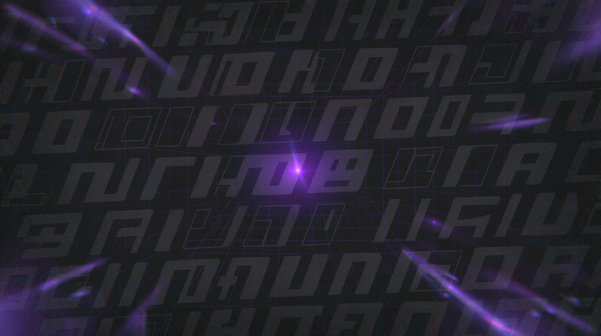

# KzzZ-Grid



> 一个可实时调参的程序化网格背景生成器 —— 文字纹理与交互网格自由叠加，一键离线导出视频与图片。

**KzzZ-Grid** 把两类视觉元素组合在同一张画布上：程序化生成的文字平铺纹理（KzzZ 描边 + AIGC 实心，砖墙式错开滚动），以及带鼠标交互的几何网格（点亮、涟漪、发光、3D 倾斜）。所有参数都能在右侧面板实时调节，所见即所得。

它不只是预览工具 —— 内置的导出面板可以把当前画面离线编码成视频，**不用像录屏那样等待真实时长**，10 秒的 720p 视频约 3 秒即可生成。

## ✨ 核心特性

- **双层画布叠加**：文字纹理层 + 网格层独立控制透明度、速度与颜色
- **文字纹理 TextGrid**：KzzZ（描边斜体）与 AIGC（实心）同行交替、上下行错开；字号、倾角、字距、方向、滚动速度全可调
- **交互网格 ShapeGrid**：8 种格子形状（方形/圆角/六边形/三角/菱形/圆/十字/点）、滚动、鼠标点亮、点击涟漪、彩虹渐变、拖尾、发光、边缘淡出、3D 倾斜
- **实时参数面板**：所有改动即时反映在画布上，配置自动保存到本地
- **离线导出**：
  - **Video** — WebCodecs 逐帧编码，MP4 (H.264) / WebM (VP9)，可选尺寸、倍率、帧率、码率、时长、无缝循环
  - **Image** — 当前帧导出 PNG / JPG
  - **Code** — 导出当前参数为 JSON + JSX，直接复用到项目
- **导出隔离**：导出面板打开时自动切断鼠标对背景网格的控制并清除已有高亮，保证导出画面干净无干扰

## 🚀 快速开始

```bash
npm install
npm run dev
```

打开 http://localhost:5173/ ，右侧面板调参，右上角「⇩ 导出」打开导出面板。

生产构建：

```bash
npm run build
npm run preview
```

## 🛠 技术栈

Vite 5 · React 18 · Canvas 2D · WebCodecs · mp4-muxer · webm-muxer

## 📁 项目结构

```
src/
├── App.jsx              # 演示页与参数面板
├── TextGrid.jsx/.css    # 文字平铺纹理组件
├── ShapeGrid.jsx/.css   # 交互网格组件
├── ExportPanel.jsx/.css # 导出面板与离线编码
└── main.jsx
```

## 💡 实现亮点

- **无缝平铺**：瓦片在左右各补一个周期，跨边界的词被完整裁切，滚动时无接缝
- **离线快进编码**：两个画布都提供 `renderAt(time)` 接口，按纯时间计算位移逐帧重绘，导出速度与实时时长解耦
- **浏览器原生编码**：H.264 / VP9 由 WebCodecs 直接编码，不依赖服务端或录屏
